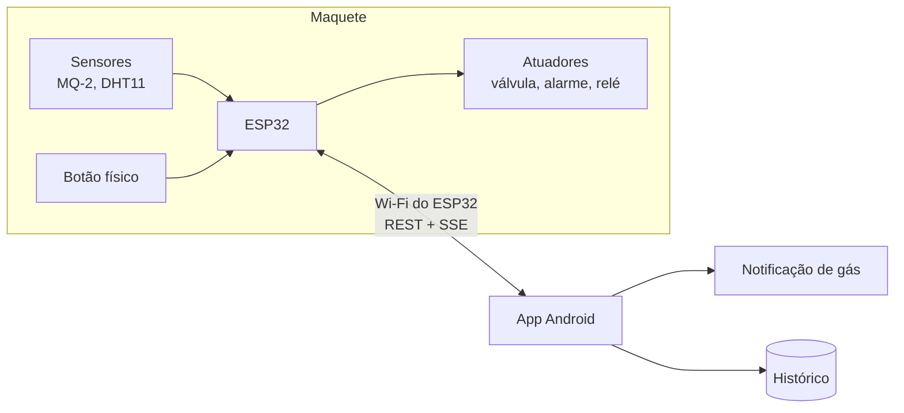

# CISC Smart Home

[](https://github.com/gustavommcv/cisc-smart-home/actions/workflows/firmware.yml)

**CISC** vem de **C**asa **I**nteligente **S**egura e **C**onfortável: um sistema que monitora a casa e avisa o morador no celular, com uma maquete física como demonstração.

Um ESP32 lê os sensores e decide sozinho o que fazer. Um aplicativo Android, conectado à rede Wi-Fi do próprio ESP32, mostra o estado da casa, guarda o histórico e emite alertas.

Projeto acadêmico da disciplina de Sistemas Eletroeletrônicos (Atividade 03), escrito para crescer: o código foi organizado como se um dia fosse virar um aplicativo de verdade.

> **Estado atual:** documentação e arquitetura. O firmware e o aplicativo serão construídos por fases, com testes, em pequenos pull requests. Veja o [plano](#fases).

## O que ele faz

A maquete tem dois cômodos, cada um com um sistema real.

| Cômodo | Dispositivo | O que acontece |
|---|---|---|
| **Cozinha** | Sensor de gás (MQ-2) | Vazamento fecha a válvula, liga o alarme e dispara um **alerta no Android**. A válvula só reabre pelo **botão físico**, na cozinha, depois que o gás sumiu |
| **Quarto** | Sensor do armário (DHT11) e desumidificador | O app mostra temperatura e umidade e **liga ou desliga o desumidificador** à distância. Em modo **Automático**, o ESP32 segue a regra de umidade. Em modo **Manual**, vale o seu comando |

O aplicativo também mostra, de forma discreta, que a casa pode crescer: há botões **bloqueados** para adicionar cômodos e dispositivos. Eles existem só como efeito de maquete.

## Como funciona



- O ESP32 cria a sua **própria rede Wi-Fi**. Não depende de internet nem de roteador, o que torna a demonstração previsível.
- O app pede dados e envia comandos por **REST** e recebe leituras e alarmes em tempo real por **SSE**.
- A **segurança não depende do celular**: a regra do gás roda no ESP32, mesmo sem o app.

As decisões por trás disso estão em [`docs/decisoes`](docs/decisoes) e a visão completa, em [`docs/arquitetura.md`](docs/arquitetura.md).

## Hardware da maquete

| Peça | Pino do ESP32 | Observação |
|---|---|---|
| Sensor de gás MQ-2 (AO) | GPIO 34 | Divisor de tensão 10 kΩ + 2 × 10 kΩ: o ESP32 aceita no máximo 3,3 V |
| Sensor DHT11 | GPIO 4 | Alimentado em 3,3 V |
| Botão de rearme | GPIO 27 | Módulo de 3 pinos |
| Módulo relé (desumidificador) | GPIO 26 | |
| Buzzer ativo | GPIO 25 | |
| Servo SG90 (válvula) | GPIO 13 | Fonte própria, com GND comum |
| LED de alarme | GPIO 2 | |
| Display LCD I2C (opcional) | GPIO 21 e 22 | Por um conversor de nível 3,3 V ↔ 5 V |

## Estrutura do repositório

Esta é a estrutura **planejada**. As pastas aparecem conforme as fases avançam.

```text
cisc-smart-home/
├── firmware/    ESP32 em C++ (PlatformIO), com o domínio testável no computador (já existe)
├── android/     aplicativo em Kotlin + Jetpack Compose (já existe)
├── hardware/    esquemático (KiCad) e lista de materiais
└── docs/        arquitetura, decisões (ADRs) e o contrato da API
```

## Documentação

- [Arquitetura](docs/arquitetura.md): camadas do firmware e do app, modelo de dados, conexão, alertas e testes
- [API](docs/api.md): o contrato entre o app e o ESP32
- [Roteiro de teste da maquete](docs/roteiro-maquete.md): o que conferir na placa depois de gravar o firmware
- [Decisões de arquitetura](docs/decisoes): o porquê de cada escolha, com as alternativas descartadas

## Ferramentas de desenvolvimento

| Para quê | O quê |
|---|---|
| Firmware | PlatformIO 6 e um compilador C++ no computador, para os testes. A placa usa o núcleo Arduino-ESP32 3.3.12, que o PlatformIO baixa sozinho |
| App | Android SDK com a plataforma 37 e o JDK 21 (o Gradle o encontra sozinho). O Gradle vem pelo wrapper do projeto |
| Testar no celular | `adb` e um celular com depuração USB |

Testes do firmware, que rodam no computador e não precisam da placa:

```bash
cd firmware
pio test -e native
```

Compilar, gravar no ESP32 e acompanhar o Serial:

```bash
cd firmware
pio run -e esp32dev -t upload
pio device monitor
```

Testes do app, que também rodam no computador, e o APK de teste:

```bash
cd android
./gradlew testDebugUnitTest assembleDebug
```

Instalar no celular (com a depuração USB ligada):

```bash
adb install -r android/app/build/outputs/apk/debug/app-debug.apk
```

## Fases

Cada fase é um pull request pequeno, com testes escritos antes do código.

| # | Fase | Estado |
|---|---|---|
| 1 | README e decisões de arquitetura | concluída |
| 2 | Firmware: domínio com testes (gás, umidade, modo automático e manual, histórico) | concluída |
| 3 | Firmware: aplicação, hardware, API e rede. Em quatro partes: **3a** contrato da API e camada de aplicação, **3b** hardware, **3c** núcleo da API (JSON, comandos, histórico e eventos), **3d** rede própria e servidor | concluída |
| 4 | App Android. Em quatro partes: **4a** esqueleto e CI, **4b** modelo e dados (comunicação com o ESP32 e histórico), **4c** telas, **4d** conexão ao ESP32 e alertas | 4a em andamento |
| 5 | Esquemático, tabela de custos e material da apresentação | |

## Licença

[MIT](LICENSE)
