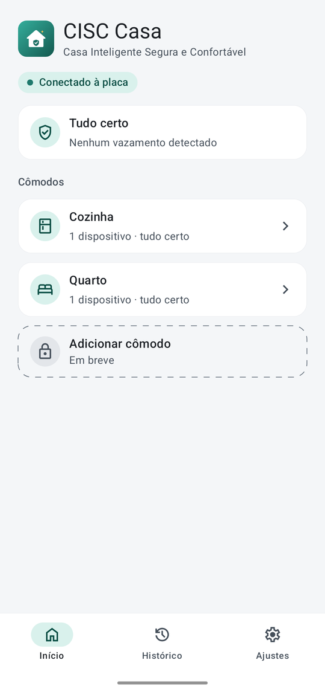
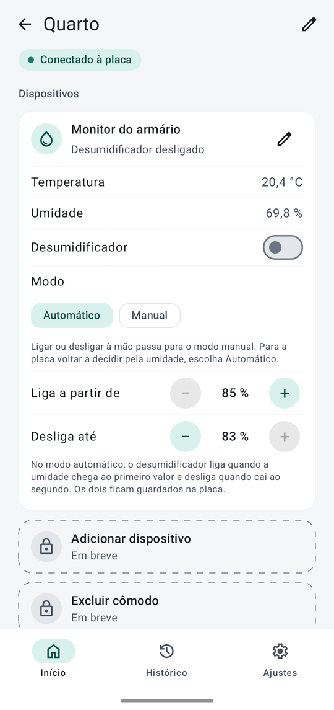
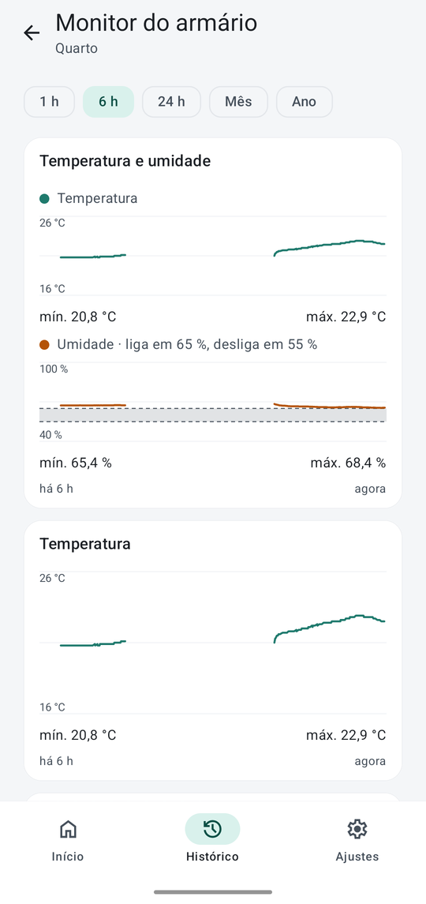
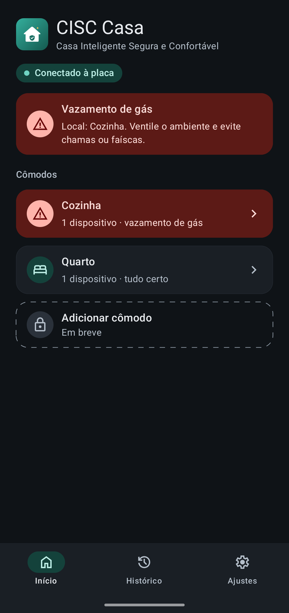
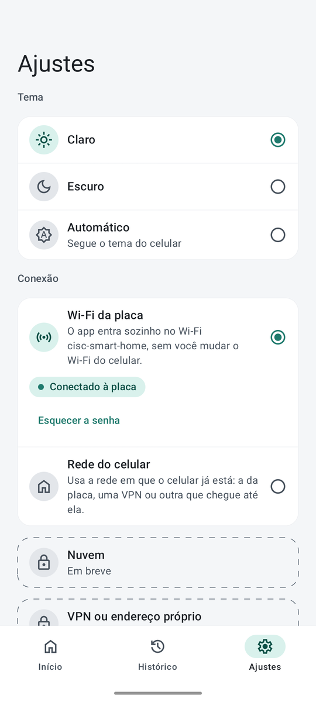
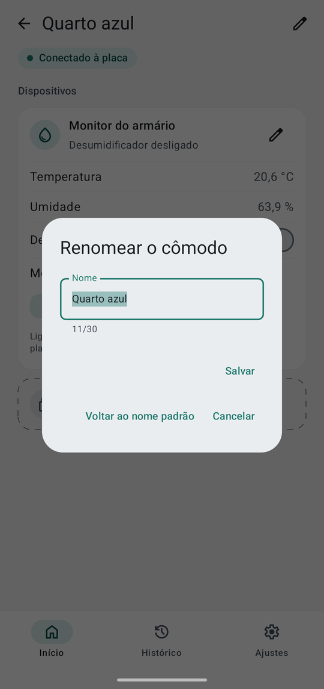

# App Android

O aplicativo do CISC Smart Home: mostra a casa, comanda o desumidificador e avisa do vazamento de gás, conversando com o ESP32 pelo contrato de [`docs/api.md`](../docs/api.md). É escrito em Kotlin, com a interface em Jetpack Compose.

> **Estado atual:** o app fala com a placa e mostra **como a casa está** (um resumo, os cômodos e, em cada um, os dispositivos), **comanda o desumidificador**, mostra **o histórico das leituras num gráfico**, **avisa de um vazamento de gás por notificação**, também com a tela apagada, e deixa o usuário **escolher o tema** (claro, escuro ou automático). O usuário também pode **dar nome aos cômodos e aos dispositivos**, e o alarme diz o nome que ele deu. O app **entra sozinho no Wi-Fi da placa**, sem mudar o Wi-Fi do celular, por uma conexão que se pode trocar (a nuvem e a VPN ficam para depois; veja as [fases](../README.md#fases)).

## Como é o app

As telas, tiradas de um celular de verdade (um Moto G85) ligado à maquete.

| Início | Cômodo | Histórico |
|:---:|:---:|:---:|
|  |  |  |

| Vazamento de gás (tema escuro) | Ajustes | Renomear |
|:---:|:---:|:---:|
|  |  |  |

As imagens mostram só o app: a barra de status do celular foi cortada. Para refazê-las, com o celular em modo de depuração e ligado à maquete, use `adb exec-out screencap -p > tela.png` e corte os primeiros 110 pixels de cima.

## Ferramentas

- **Android SDK** com a plataforma **37** (usada para compilar) e o build-tools 36. O app mira a API **36**, o Android do celular de teste, e exige **Android 10 (API 29)** ou mais, que é quando um app passou a poder entrar sozinho numa rede Wi-Fi sem internet.
- **JDK 21.** Você não precisa configurar o `JAVA_HOME`: o arquivo [`gradle/gradle-daemon-jvm.properties`](gradle/gradle-daemon-jvm.properties) faz o Gradle achar o JDK 21 por conta própria, mesmo que o Java padrão do seu sistema seja outro. O código em si é compilado com o JDK 17, que o Gradle baixa se faltar.
- **Gradle**, pelo wrapper (`./gradlew`).

Crie o `android/local.properties` (o Git o ignora) apontando para o seu SDK:

```properties
sdk.dir=/caminho/para/o/Android/Sdk
```

## Comandos

Tudo a partir desta pasta:

```bash
./gradlew testDebugUnitTest     # os testes, no computador
./gradlew lintDebug             # a análise estática
./gradlew assembleDebug         # o APK de teste, em app/build/outputs/apk/debug/
```

Instalar no celular, com a depuração USB ligada:

```bash
adb install -r app/build/outputs/apk/debug/app-debug.apk
```

O APK de teste é assinado com a chave de depuração do Android, que basta para instalar. Não há assinatura de versão.

## Organização

```text
app/src/main/kotlin/io/github/gustavommcv/ciscsmarthome/
├── domain/    modelos e regras, sem Android (Home, Area, Device, Entity, e as regras de tempo e de alerta)
├── data/      o cliente do ESP32 (REST + SSE), o histórico local e os repositórios; hoje, `data/remote` com o cliente REST e o dos eventos, `data/link` com a conexão à placa, `data/local` com o histórico e `data/repository` com o repositório
├── ui/        as telas em Compose e um ViewModel por tela; `ui/theme` guarda o visual (cores, formas, espaços), `ui/components` as peças que as telas repartem, `ui/navigation` a barra de baixo e `ui/history` o gráfico
├── service/   o serviço que mantém a conexão e dispara as notificações
├── di/        a montagem das dependências, sem framework
├── CiscApplication.kt    cria a montagem quando algo a pede pela primeira vez e inicia o serviço
├── AppDependencies.kt    o que a tela e o serviço pedem à aplicação (elas não podem se importar)
└── ConnectionMessages.kt o texto de cada estado da conexão, na tela e na notificação
```

Cada pasta nasce junto com o primeiro arquivo que ela guarda. Hoje existem `ui/`, `domain/`, `data/`, `di/` e `service/`.

### O domínio

Kotlin puro, testado só com JUnit. Além da biblioteca padrão, usa apenas as corrotinas, pelo `Flow` do `HistoryStore` e o `Channel` do `LeakAnnouncer`:

| Arquivo | O que faz |
|---|---|
| `Home` | A casa como a placa a descreve: cômodos, dispositivos e entidades (`Sensor`, `BinarySensor`, `Switch` e `Select`), com um valor nulo quando não há leitura válida. Acha uma entidade pelo `id` e diz em que dispositivo e cômodo ela está |
| `DeviceClock` | Põe o `uptimeMs` da placa no relógio do celular, como pede a seção "Tempo" de [`docs/api.md`](../docs/api.md). A placa não guarda hora: o celular anota a diferença a cada resposta, uma por partida |
| `HistoryStore` | O histórico que o app guarda e continua tendo depois de fechado: salva amostras (cada uma já na hora do celular), diz até onde o histórico de uma partida vai, para perguntar à placa só o que é mais novo, e devolve a série de uma entidade, que se renova quando chegam amostras |
| `Contract` | Os ids e as palavras de [`docs/api.md`](../docs/api.md) que o app precisa conhecer (`EntityIds`, `AreaIds`, `DeviceIds`, `GasStates`, `DehumidifierModes`, `AlertTypes`), **escritos uma vez só**. O resto do código os nomeia em vez de soletrá-los. O `ContractTest` lê o documento e confere cada um, então um id digitado errado, ou que mudou no contrato, quebra um teste em vez de falhar calado na tela |
| `GasLeakStatus` | O que a casa diz sobre vazamentos de gás: quantos houve desde que a placa ligou e se há um agora, lidos de `gas-state` e `gas-alerts`. Se a casa não diz (falta uma das duas entidades ou a contagem não é legível), não diz nada: sem a contagem, um vazamento não se distingue de um já avisado |
| `HomeRepository` | O que as telas e o serviço enxergam da casa, venha como vier: a casa (`home`), o estado da conexão (`connection`), os vazamentos que são notícia (`alerts`), a série de uma entidade, o envio de comandos e o `keepSynced`, que o serviço da 4d roda em segundo plano. Os tipos que a acompanham: `ConnectionState`, `ConnectionProblem`, `CommandResult` e `GasAlert` |
| `AlertTracker` | Decide quando um vazamento é notícia. O par (identificador de partida, contador de vazamentos) dá nome a cada um, então o mesmo vazamento é avisado **uma vez**, chegue pelo evento `alert`, pelo estado da casa ao reconectar, ou pelos dois. Vazamentos que terminaram enquanto o app estava fora não avisam depois. Guarda o que já foi avisado, para não repetir nem depois de o app reiniciar |
| `LeakAnnouncer` | Põe o `AlertTracker` para trabalhar: recebe cada evento de vazamento e cada estado da casa, avisa em `alerts` os que são notícia e entrega o que já foi avisado ao `AlertMemory`, que o guarda no celular, **só quando muda**. O que ninguém recebeu ainda espera na fila, então um vazamento não se perde entre a placa avisar e o serviço estar ouvindo |

O domínio também tem o `HistorySample` e o `HistoryPage` (as leituras guardadas pela placa), o `CommandValue` (o que o usuário pede a uma entidade: ligar ou desligar, ou escolher uma opção) e o `HomeEvent` (o que a placa anuncia sozinha: a casa mudou, ou um vazamento de gás começou). As interfaces do domínio nascem junto com o primeiro código que as implementa ou usa: o `HistoryStore` nasceu com o banco e o `HomeRepository` com o repositório. Criá-las antes seria código sem uso.

### O cliente REST

Em `data/remote`, o lado REST do contrato de [`docs/api.md`](../docs/api.md). Usa OkHttp para a rede e `kotlinx.serialization` para o JSON.

| Arquivo | O que faz |
|---|---|
| `BoardClient` | Lê a casa, manda um comando a uma entidade e busca o histórico (com `after` e `limit`). Cada chamada **devolve** o que deu, em vez de lançar exceção. Não escolhe a rede, o endereço nem os tempos limite: quem o cria os dá, e por isso os testes o apontam para um servidor falso. Se a corrotina for cancelada, a chamada à placa é cancelada junto. **Pode ser chamado de qualquer thread**, até da principal: a chamada inteira, inclusive a leitura do corpo da resposta, que é uma espera na rede, roda na thread de E/S (o Android derruba o app que lê a rede na thread principal) |
| `BoardResult` e `BoardError` | O resultado: a resposta, ou por que não houve. A placa **não respondeu** (`Unreachable`: sem rede, rede errada, lenta demais), **respondeu com um erro do contrato** (`Rejected`, com o código reconhecido) ou **respondeu o que o app não entende** (`Unexpected`) |
| `BoardDtos` e `BoardMapping` | O JSON como ele viaja, e a tradução para o domínio. O app é **tolerante**, como o contrato pede: ignora campos desconhecidos, descarta entidades de um tipo que não conhece, e um valor que não combina com o tipo conta como "sem leitura válida" |

### Os eventos

Também em `data/remote`, o lado SSE do contrato: o fluxo `GET /api/v1/events`, lido com o `okhttp-sse`.

| Arquivo | O que faz |
|---|---|
| `BoardEventStream` | Ouve o fluxo e **continua ouvindo**: quando a conexão cai, por qualquer motivo, avisa e conecta de novo sozinho. Quem o usa recebe um `Flow` e cancela o `Flow` para parar, o que cancela a chamada à placa |
| `BoardStreamUpdate` | O que o fluxo conta: `Connected` (a placa aceitou), `Received` (a placa anunciou algo) e `Lost` (a conexão caiu, e por quê, com o mesmo `BoardError` do cliente REST) |
| `Backoff` | A espera entre as tentativas: 1 s depois da primeira falha, o dobro a cada falha seguida, no máximo 10 s. Volta a 1 s depois de uma conexão que funcionou |
| `BoardDecoding` | A leitura que o cliente REST e o fluxo dividem: a casa (com a conferência da versão da API) e o erro do contrato. Também lê o `alert` |

Três decisões que não aparecem no código à primeira vista:

- **"20 segundos sem receber nada" é o tempo limite de leitura da conexão.** O contrato manda reconectar depois de 20 s de silêncio, e é exatamente o que o tempo limite de leitura do OkHttp faz: qualquer byte recebido, inclusive um `ping`, zera a contagem. Por isso o fluxo não conta o tempo por conta própria. Em compensação, ele troca o tempo limite de leitura do cliente que recebe. O tempo limite da chamada continua valendo só até a conexão abrir; depois o `okhttp-sse` o desliga, porque cortaria um fluxo feito para durar.
- **O `alert` não diz de qual partida da placa é.** O app usa o `bootId` do `home` que a placa envia logo ao conectar, na mesma conexão. Uma conexão não atravessa um reinício, então esse `bootId` vale para todos os alertas dela. Um `alert` que chegue antes de qualquer `home` é descartado.
- **O que o app não consegue ler é pulado, e o fluxo continua.** Todo `home` traz o estado inteiro, então o próximo conserta o que se perdeu. Até um `alert` perdido não passa em branco: o vazamento aparece no `home` seguinte, por `gas-state` e `gas-alerts`, e o `AlertTracker` avisa por ali.


### O repositório

Em `data/repository`, o `HomeRepositoryImpl` junta o que o app tem (o cliente REST, os eventos, o histórico local e as regras do domínio) no que as telas e o serviço leem. Ele **decide o que fazer com cada coisa que a placa diz** e deixa o fazer para duas peças pequenas:

| Peça | O que faz |
|---|---|
| `HomeRepositoryImpl` | Coordena: guarda a casa e o estado da conexão, reage a cada evento do fluxo e envia os comandos |
| `HistorySync` | Busca o histórico que o celular não tem, uma página por vez, e o guarda já na hora do celular |
| `LeakAnnouncer` (no domínio) | Faz de cada vazamento uma notícia, uma vez só, e lembra o que já avisou |

Cada uma tem testes próprios, sem precisar do repositório inteiro; os do repositório conferem que ele as liga do jeito certo.

`BoardClient` e `BoardEventStream` implementam `BoardApi` e `BoardEvents`, duas interfaces pequenas em `data/remote`. É por elas que os testes do repositório usam fakes: a rede já foi testada contra um servidor falso nas partes anteriores, e aqui só importa o que o repositório faz com o que recebe.

O `keepSynced` reage ao que o fluxo de eventos conta, um evento por vez:

- **A placa aceitou a conexão** (`Connected`): pede a casa por REST, o que também mostra se a placa é utilizável (a versão da API que o app não conhece aparece aqui como `Incompatible`), e o `HistorySync` busca o histórico que falta. O `after` é até onde o app já tem *daquela partida*, então uma partida nova começa do zero mesmo que as antigas estejam guardadas. As páginas são de 360 amostras, que é o que a placa guarda; uma página que não enche é o fim, e uma que não avança também (uma placa que funciona não manda essa).
- **Chegou um evento**: prova que a conexão está viva, então o estado vira `Connected` mesmo que o pedido da casa tenha falhado.
- **A conexão caiu** (`Lost`): o estado vira `Disconnected` com o motivo, e a última casa continua em `home`. Quem reconecta é o próprio fluxo.
- **A casa que chega** só vale se não for mais velha que a que o app já tem *da mesma partida*: a resposta REST e o fluxo podem se cruzar. Uma partida nova vale sempre, mesmo com `uptimeMs` menor.
- **A hora das amostras** é a do celular: o `DeviceClock` aprende a diferença a cada casa que chega, e o `HistorySync` a usa para datar o histórico antes de guardá-lo.
- **Vazamentos** passam pelo `LeakAnnouncer` (e por dentro dele, pelo `AlertTracker`), venham pelo evento `alert` ou pelo estado da casa. Quem avisa o usuário (a 4d) lê `alerts`, que guarda o que ninguém recebeu ainda, então um vazamento não se perde entre a placa avisar e o serviço estar ouvindo.

Só o `keepSynced` mexe no `DeviceClock` e no `LeakAnnouncer`, que não foram feitos para vários fios, então não precisam de trava. O `send`, que roda no fio de quem chama, só troca a entidade em `home`, que aguenta isso.

### O histórico local

Em `data/local`, o `RoomHistoryStore` guarda o histórico num banco do Room, no celular.

| Arquivo | O que faz |
|---|---|
| `HistoryDatabase` | O banco: uma tabela, `reading`, com **uma linha por entidade de cada amostra**. Uma entidade nova (um terceiro sensor, por exemplo) não precisa de coluna nova nem de migração |
| `RoomHistoryStore` | Implementa o `HistoryStore`: traduz o domínio para as linhas e de volta |

- **A chave é (partida, `uptimeMs`, entidade)**, o par que o contrato manda usar para saber se uma amostra já existe. Salvar uma amostra que já está lá deixa a que estava: o app pode pedir a mesma página duas vezes sem repetir nada.
- **A hora é gravada, não calculada na leitura.** Quem salva (o `HistorySync`) converte o `uptimeMs` pelo `DeviceClock` e passa a hora do celular. Assim o histórico de uma partida antiga continua certo depois de o app fechar, quando o `DeviceClock` já esqueceu a diferença dela.
- **O formato do banco fica no Git**, em [`app/schemas`](app/schemas). O Room o gera a cada compilação, então uma mudança no formato aparece na revisão, e uma versão futura pode ser migrada a partir dele.
- **Por enquanto o app guarda tudo**: a placa faz uma amostra a cada 10 s e hoje são três entidades no histórico, então uns 26 mil registros por dia, alguns megabytes. Limpar o que for muito antigo entra quando houver a tela do histórico e se souber quanto ele precisa mostrar.

Os testes usam o **Robolectric**, que roda um Android de verdade no computador, para o Room trabalhar com o banco de verdade, sem celular e sem emulador. Dois detalhes: o Robolectric só roda o Android 16 (SDK 36) no Java 21, e o app compila com o 17, então estes testes rodam no SDK 35 (veja `robolectric.properties`); e na primeira vez ele baixa o Android para `~/.m2` (uns 200 MB), o que a próxima execução não repete.

### A montagem e a primeira conexão

O `AppContainer`, em `di/`, monta as peças à mão: o cliente HTTP (com tempo limite de 5 s, porque a placa está na rede do próprio celular e responde em milissegundos ou não responde), o banco do histórico, o link até a placa (veja [A conexão com a placa](#a-conexão-com-a-placa)), o cliente REST, o fluxo de eventos e o repositório. É o único lugar onde as camadas se encontram. Um framework de injeção seria mais para ler do que a montagem em si. O container só monta: quem põe o `keepSynced` do repositório para rodar é o serviço (veja abaixo). A `CiscApplication` o cria quando algo o pede pela primeira vez, e **não inicia nada sozinha**.


A placa fala HTTP sem certificado, então o HTTP puro é **liberado só para `192.168.4.1`** e recusado para todo o resto, em [`network_security_config.xml`](app/src/main/res/xml/network_security_config.xml). O `ManifestTest` guarda isso: a recusa por padrão, o único endereço liberado, e que ele é o mesmo que o app usa (`AppContainer.BOARD_URL`).

### A conexão com a placa

Como o app chega à placa é decidido num lugar só, o `BoardLink`, em `data/link`. O `BoardClient` e o `BoardEventStream` falam o contrato com o endereço e o cliente HTTP que recebem; quem **escolhe o caminho** é o link. A [decisão 0010](../docs/decisoes/0010-conexao-do-app-com-a-placa.md) diz por quê, com o que se mediu no celular.

| Peça | Onde | O que faz |
|---|---|---|
| `BoardLink` e `BoardRoute` | `data/link` | O link diz uma **rota**: `Joining` (está entrando), `Open` (o endereço e um cliente HTTP que já anda pelo caminho certo) ou `Closed` (não há caminho, e o motivo). `keepUp()` faz o que o link precisa fazer e continua fazendo, até ser cancelado; cancelar devolve o que ele segurava |
| `WifiAccessPointLink` | `data/link` | Faz o celular entrar no Wi-Fi da placa pelo nome e pela senha. Sem senha, a rota diz isso e **nada é pedido**. Um pedido que o celular desiste, ou uma rede que cai, é refeito depois de uma espera que cresce (5 s até 30 s), **depois de soltar o pedido anterior**: o celular nunca recebe dois. Uma senha nova troca o pedido na hora |
| `NetworkJoiner` e `AndroidNetworkJoiner` | `data/link` | O celular, pedido para entrar numa rede. O `AndroidNetworkJoiner` usa o `WifiNetworkSpecifier` e diz o que o Android diz (entrou, perdeu, não deu); o pedido vale enquanto o fluxo é coletado. Cada rede que entra traz um cliente HTTP com os **soquetes presos a ela**, e nada mais é preso. O tempo limite de cada tentativa é de 40 s |
| `DirectLink` | `data/link` | Não faz nada: usa a rede em que o celular já está. É a opção "Rede do celular", o plano B |
| `ChosenLink` | `data/link` | O link que o usuário escolheu. Quando a escolha muda, para o link em uso e levanta o novo, sem reiniciar o app |
| `RoutedBoardApi` e `RoutedBoardEvents` | `data/link` | O `BoardApi` e o `BoardEvents` pela rota do momento. Sem caminho, a chamada falha sem tentar, dizendo por quê (`BoardError.NoRoute`); uma rota que fecha é uma **perda** como outra qualquer. O `RoutedBoardEvents` mantém o link de pé enquanto o repositório sincroniza |
| `LinkKind` e `LinkSettings` | `domain` | As escolhas do usuário (`BoardWifi`, `CurrentNetwork`) e o que o app guarda delas: a escolha e a senha do Wi-Fi da placa |
| `PreferencesLinkSettings` | `data/local` | Guarda as duas num arquivo só do app (`link-settings`, chaves `link` e `board-password`). Uma escolha que o app não conhece vale como nenhuma, e o padrão é o Wi-Fi da placa |
| `WifiPanel` | `ui/settings` | Decide o que o cartão do Wi-Fi da placa mostra: o campo da senha só sem senha ou quando o celular não entra na rede, e o "Esquecer a senha" quando há uma |
| `WifiPassword` | `domain` | O que uma senha WPA2 pode ser: de 8 a 63 caracteres ASCII imprimíveis. A tela recusa o resto antes de pedir ao celular |

O `AppContainer` é onde se escolhe o que cada `LinkKind` constrói. **Para chegar à placa de outro jeito** (a nuvem, uma VPN), acrescenta-se um valor em `LinkKind`, um link em `data/link` e uma linha no `when` do `AppContainer`. As telas, o serviço e o repositório não mudam.

Na aba de Ajustes, **Conexão** mostra as duas escolhas e, **embaixo da que está valendo, se ela funciona** (o mesmo "Conectado à placa" do início, ou o motivo de não estar conectado). **A senha só aparece quando é preciso**: quando ainda não há uma ou quando o celular não consegue entrar na rede (a senha pode estar errada). Com a placa ouvida, o cartão mostra só o estado e o botão **Esquecer a senha**, que joga a senha fora, solta a rede e traz o campo de volta. A senha digitada não se vê, a não ser pelo "Mostrar", e o campo é limpo depois de guardada. "Nuvem" e "VPN ou endereço próprio" aparecem como cartões de "Em breve" (veja a [decisão 0010](../docs/decisoes/0010-conexao-do-app-com-a-placa.md) sobre por que são dois tipos diferentes).

**Dois motivos novos de conexão perdida**, ditos no banner e na notificação: **falta a senha** do Wi-Fi da placa, e **não deu para entrar** nela (a placa está desligada ou longe, a senha está errada, ou o aviso do Android não foi aceito).

**O que o usuário vê:**

- **Na primeira vez**, o Android pergunta se o app pode entrar na rede `cisc-smart-home`. Aceite. Ele lembra a resposta, a não ser que você "esqueça" a rede nas configurações do Wi-Fi.
- **O Wi-Fi de casa do celular fica de lado** enquanto o app está ligado à placa, porque o rádio é um só. Voltar para a "Rede do celular", ou fechar o app, o devolve.
- Se a placa some e volta (ficou sem energia, por exemplo), **o app volta sozinho**, em cerca de um minuto.
- **Testado só no Android 16** (um Moto G85). Em versões mais antigas, o Android pode pedir outras permissões.

### As telas

Dentro da aba Início há três telas, escolhidas por `HomeContent` a partir do estado do `HomeViewModel` (`HomeState`: a casa, a conexão e qual tela está aberta):

| Tela | Quando aparece | O que mostra |
|---|---|---|
| **Cômodos** (`RoomsScreen`) | Há uma casa para mostrar | No topo, **um cartão que diz como a casa está** ("Tudo certo", ou "Vazamento de gás" com o cômodo e o que fazer). Depois, a seção "Cômodos", com **um cartão por cômodo**: o ícone, o nome e uma linha como "1 dispositivo · tudo certo", com uma seta. O cartão não mostra leituras; elas estão no cômodo. O cômodo com vazamento fica **vermelho, com um aviso**. No fim, o cartão **bloqueado** "Adicionar cômodo / Em breve" |
| **Cômodo** (`RoomScreen`) | Toque num cartão | A seção "Dispositivos", com **um cartão por dispositivo**: o ícone, o nome e como ele está ("Normal", "Desumidificador desligado") e, dentro do cartão, o que ele lê e **os controles do que a placa aceita comandar** (no quarto, um interruptor para ligar e desligar o desumidificador e a escolha entre Automático e Manual). O dispositivo que lê o vazamento fica vermelho. No fim, o cartão bloqueado "Adicionar dispositivo". O botão de voltar do sistema volta para a lista |
| **Sem casa** (`NoHomeScreen`) | O app ainda não ouviu a placa | Uma espera, ou, se a placa não pode ser alcançada, o que conferir (o texto muda com o motivo: outra rede, conexões demais, versão diferente, falta a senha do Wi-Fi da placa, não deu para entrar nele) |

**Os controles** seguem poucas regras, todas em funções puras e no `HomeViewModel`, testadas sem celular:

- **Só funcionam com a placa ouvida.** Sem conexão ficam desativados: um comando mandado ao vazio só diria que falhou (`Entity.controlEnabled`).
- **Um comando de cada vez por entidade.** Enquanto o anterior espera a resposta, o controle fica desativado e um segundo toque não manda nada, então um toque duplo é um comando, não dois.
- **A tela não adivinha.** O interruptor só muda quando a placa responde: o repositório troca a entidade pela resposta da placa. Se o comando falhar, o controle continua como estava e **uma mensagem aparece uma vez** (a placa não aceitou, não foi possível falar com ela, ou ela respondeu algo que o app não entende); ela não fica na tela como se fosse um estado do cômodo.
- **Ligar ou desligar à mão passa a placa para o modo manual**, como diz o contrato (`docs/api.md`). A tela avisa isso embaixo da escolha do modo, e a mudança do modo chega pelo fluxo de eventos em cerca de um segundo. Para a placa voltar a decidir pela umidade, é só escolher Automático.
- **Tocar no modo que já está escolhido não manda nada.**

Os textos do app são em português; `tools:locale="pt"` no `strings.xml` diz isso ao lint, que senão trata o texto padrão como inglês e acusa palavras em português como erro de digitação.

Quando a conexão cai **com uma casa já lida**, o app não esconde o que sabe: mostra a última leitura, com os cartões mais claros e o aviso "Sem conexão… Mostrando a última leitura". Mentir com um valor velho como se fosse novo seria pior que dizer que é velho.

O que cada cartão diz, os nomes e as palavras da tela ficam em funções puras, testadas sem celular: `Area.status()` e `Home.status()` dizem como o cômodo e a casa estão, `Resources.roomSubtitle()` e `summaryTitle()`/`summaryText()` dizem isso em palavras (com o plural certo: "1 dispositivo", "2 dispositivos"), `Device.headline()` e `Device.rows()` dizem o que vai embaixo do nome do dispositivo e o que vai nas linhas, e `Labels.kt` traduz o que a placa nomeia em inglês: as entidades (`gas-state` vira "Gás"), os dispositivos (`closet-monitor` vira "Monitor do armário") e as palavras (`emergency` vira "VAZAMENTO"; `automatic` vira "Automático"). **Os números sempre saem no formato português** (`18,4 °C`), mesmo com o celular em inglês: o app é em português, e uma tela que diz "Temperatura" ao lado de "18.4" parece um erro. Foi o que o primeiro teste no celular mostrou. **O que o app não conhece aparece como a placa o nomeou**, então uma entidade ou um cômodo novo da placa aparece mesmo sem tradução. Os nomes dos cômodos (`AreaId.nameRes()`) são os mesmos da tela e da notificação do vazamento.

**"Tudo certo" só quando é verdade.** O estado de um cômodo vai do pior ao melhor: **vazamento** (o estado do gás diz `emergency`), **sensor aquecendo** (`starting`: ainda não dá para dizer se há vazamento), **N sem leitura** (leituras que a placa não mandou, de qualquer tipo de entidade, ou um estado do gás que o app não entende) e **tudo certo**. A casa tem o pior estado dos seus cômodos, e as leituras que faltam em todos eles se somam. Um sensor de gás aquecendo ou uma leitura que não chegou nunca vira "tudo certo": numa casa com gás, dizer que está tudo bem sem saber seria o pior erro. Um vazamento aparece pelo **estado do gás**, sem esperar a contagem de vazamentos que o alarme exige (`GasLeakStatus`), então o cartão vermelho nunca fica de fora por falta de um dado que só o alarme precisa. Um cômodo sem dispositivos não diz "tudo certo": diz "Nenhum dispositivo".

**O dispositivo é a unidade** (decisão [0004](../docs/decisoes/0004-modelo-comodo-dispositivo-entidade.md)): o cartão dele reúne o que ele lê e controla. Embaixo do nome ele diz uma coisa só: o estado do gás, no monitor de gás, e "Desumidificador ligado/desligado", no monitor do armário. O que já foi dito ali não se repete nas linhas, a não ser que também seja um controle (o interruptor do desumidificador continua nas linhas). Um dispositivo que o app não conhece não diz nada embaixo do nome e mostra todas as entidades que tem, com o ícone de sensor.

**Dentro do Início, a navegação também é feita à mão**: o `HomeViewModel` guarda qual tela está aberta (`Screen`), a lista ou um cômodo. Um cômodo que deixa de existir na casa fecha sozinho. Entre as abas, veja [A barra de baixo e os ajustes](#a-barra-de-baixo-e-os-ajustes).

### O visual

O visual tem um lugar só, e as telas pedem a ele em vez de soletrar cores e números. Segue o que desenhamos no mockup: um verde-azulado calmo sobre um cinza frio, e o vermelho guardado para o que está errado.

| Peça | Onde | O que faz |
|---|---|---|
| **Cores** | `ui/theme/Color.kt` | Duas paletas completas do Material 3, **clara e escura**. Os papéis que o app não usa (secundário, terciário) repetem a família do verde-azulado, para que nenhum roxo padrão do Material apareça |
| **Espaços** | `ui/theme/Spacing.kt` | Cinco degraus (`Xs`, `S`, `M`, `L`, `Xl` = 4, 8, 12, 16 e 24 dp). A tela pede um degrau, não um número, então mudar o ritmo é mexer num lugar |
| **Formas** | `ui/theme/Shape.kt` | Cantos suaves; o cartão (`large`) tem 18 dp. O que é redondo (selo de ícone, etiqueta) é círculo |
| **Tom** | `ui/components/Tone.kt` | Quão alto algo fala: `Primary` (o que está bem), `Alert` (o que pede um olhar) e `Neutral` (o resto). Cada tom diz qual cor é o fundo, qual é o texto sobre ele, a cor forte e o que se desenha sobre a cor forte |
| **Cartão** | `ui/components/CiscCard.kt` | Superfície branca com um fio fino em volta; com um tom, é o fundo desse tom (um cômodo em emergência é um cartão de alerta). Com `onClick`, o cartão inteiro recebe o toque |
| **Selo de ícone** | `ui/components/IconBadge.kt` | Um ícone num círculo de 40 dp, no tom escolhido, ou sólido para chamar atenção. Sem `contentDescription` é enfeite e o leitor de tela o ignora |
| **Etiqueta de estado** | `ui/components/StatusPill.kt` | Uma palavra curta sobre o estado, com um ponto do mesmo tom. A faixa de conexão a usa: "Conectado à placa", "Conectando à placa…" ou "Sem conexão com a placa", e, quando a conexão cai, o motivo vem logo abaixo |
| **Borda tracejada** | `ui/components/DashedBorder.kt` | O contorno do que é desenhado como um lugar e ainda não existe (os cartões "Em breve") |
| **Título de seção** | `ui/components/SectionTitle.kt` | O título pequeno que abre um grupo de cartões ("Cômodos", "Dispositivos", "Tema") |
| **Cartão bloqueado** | `ui/components/LockedCard.kt` | O "Adicionar…" que aparece desenhado, com borda tracejada e cadeado, mas ainda não existe |

**O tema é uma escolha do usuário**: claro, escuro ou automático (o do celular), na aba de Ajustes. Ver [A barra de baixo e os ajustes](#a-barra-de-baixo-e-os-ajustes).

**O contraste é garantido por teste.** O `ColorsTest` confere, nos dois temas, que todo texto tem pelo menos **4,5:1** sobre o fundo em que é desenhado (o mínimo AA da WCAG 2.1) e que o contorno de um controle tem pelo menos 3:1. O texto secundário (legendas, rótulos de baixo) tem entre 7,6:1 e 9,9:1 sobre o fundo e sobre o cartão. O `ToneTest` faz o mesmo para cada tom, e o `DimensionsTest` confere que os espaços formam uma escala na grade de 4 dp e que os cantos crescem em ordem.

**Os ícones** são o [Material Symbols](https://fonts.google.com/icons) (traço fino, 24 dp), um arquivo XML por ícone em `res/drawable/ic_*.xml`: seta de voltar, cadeado, aviso, casa, cozinha e cama, e, para a barra de baixo e a escolha do tema, relógio (histórico), engrenagem (ajustes), sol, lua e o brilho automático, e, para os cartões, o escudo com visto ("tudo certo"), a seta, a chama (monitor de gás), a gota (monitor do armário) e o sensor (dispositivo que o app não conhece). Vêm do repositório [google/material-design-icons](https://github.com/google/material-design-icons), sob a licença **Apache 2.0**, e há uma única alteração neles: o `?attr/colorControlNormal` do original virou `?android:attr/colorControlNormal`, porque o primeiro só existe com o AppCompat, que o app não usa. A cor de verdade vem do `Icon` do Compose, que pinta o ícone.

Para pôr um ícone novo: baixe `symbols/android/<nome>/materialsymbolsoutlined/<nome>_24px.xml`, salve como `res/drawable/ic_<nome>.xml`, faça a mesma troca do atributo e use `painterResource(R.drawable.ic_<nome>)`. O `SymbolIconsTest` confere que todo ícone tem 24 dp, está na grade de 960 do conjunto e desenha alguma coisa, então um tamanho ou variante errados falham no teste. A biblioteca `material-icons-core` saiu do app, o que o deixa menor.

**A aparência dos componentes não tem teste automático**: o app não usa a biblioteca de teste do Compose, então o que é lógica (qual cor, qual ícone, qual palavra) está em funções puras testadas, e o resto foi conferido no celular.

### Os nomes que o usuário dá

Um **lápis** no cabeçalho do cômodo e no cartão de cada dispositivo abre uma janela para **renomear**: o campo vem com o nome de agora, todo selecionado, e há **Salvar**, **Cancelar** e, quando o usuário já deu um nome, **Voltar ao nome padrão**. As leituras ("Temperatura", "Nível de gás") não se renomeiam. A [decisão 0009](../docs/decisoes/0009-nomes-dados-pelo-usuario.md) conta o porquê.

| Peça | Onde | O que faz |
|---|---|---|
| `Names` | `domain/Names.kt` | Os nomes dados, por id, e a regra de qual vale: **o que o usuário digitou, depois o nome em português do app, depois o da placa**. Diz também o que é um nome: sem o espaço das pontas, no máximo **30 caracteres**, e em branco não é nome |
| `NameBook` | `domain/NameBook.kt` | A interface do que está dado e de como dar ou tirar um nome |
| `PreferencesNameBook` | `data/local/` | Guarda os nomes num arquivo de preferências, um por entrada (`area:<id>`, `device:<id>`), então um cômodo e um dispositivo que dividam um id têm cada um o seu. O que o arquivo tem e não é nome é ignorado |
| `RenameDialog` | `ui/components/` | A janela: o campo para no limite, mostra quantas letras já foram e salva também pelo "Concluído" do teclado |

- **O nome aparece em todo lugar**: no cartão do cômodo, no resumo do Início ("Local: …"), no cabeçalho e nos cartões da tela do cômodo.
- **O alarme diz o nome do usuário.** O `AndroidNotifier` o lê na hora de montar o aviso ("Local: Cozinha da vó"), então um nome dado um instante antes já vale. Numa emergência, a mensagem fala a palavra que a pessoa usa para o lugar.
- **Os nomes ficam no celular**, no arquivo `user-names`, e a placa não sabe deles. Um segundo celular não os vê. O nome do arquivo e as chaves são o que o usuário já terá: um teste os guarda.

### A barra de baixo e os ajustes

O app tem **três abas**, numa barra de baixo (`BottomBar`): **Início** (a lista de cômodos e cada cômodo), **Histórico** e **Ajustes**. O `CiscApp` guarda qual está aberta e a troca; cada aba tem o seu `ViewModel` e o seu estado, então sair de uma e voltar a encontra como estava (um cômodo aberto continua aberto). O voltar do sistema leva do Histórico e dos Ajustes ao Início, e do Início fecha o cômodo e, depois, o app. A navegação é à mão, sem biblioteca; a [decisão 0007](../docs/decisoes/0007-abas-e-escolha-do-tema.md) diz por quê.

| Peça | Onde | O que faz |
|---|---|---|
| `Tab` | `ui/navigation/Tab.kt` | As três abas, a ordem, a palavra e o ícone de cada uma, e para onde o voltar vai (`back()`) |
| `BottomBar` | `ui/navigation/BottomBar.kt` | A barra: a aba aberta fica numa pílula tingida e com a palavra forte; as outras, na cor discreta |
| `HistoryScreen` e `HistoryViewModel` | `ui/history/` | O gráfico das leituras de um sensor, no período escolhido. Veja [O histórico e o gráfico](#o-histórico-e-o-gráfico) |
| `SettingsScreen` e `SettingsViewModel` | `ui/settings/` | A escolha do tema, em três linhas inteiras que recebem o toque (Claro, Escuro, Automático, este com "Segue o tema do celular"), e a conexão com a placa (veja [A conexão com a placa](#a-conexão-com-a-placa)) |

**O tema** é um `ThemeMode` (`Claro`, `Escuro`, `Automático`) do domínio, com a regra de quando o app fica escuro (`isDark`): o claro nunca, o escuro sempre, o automático como o celular estiver. **O padrão é o automático.** A escolha é guardada pelo `PreferencesThemeSettings`, num arquivo de preferências com uma palavra (o nome do valor), lida ao abrir e válida na mesma hora em que muda; uma palavra desconhecida vale como nenhuma escolha. A tela chega a ela por `AppDependencies.themeSettings`, o mesmo caminho do repositório. O arquivo se chama `theme-settings` e a chave `theme`: são o que o usuário já tem no celular, e um teste os guarda.

**As barras do sistema acompanham o tema do app, não o do celular.** Sem isso, com o app claro num celular escuro, os ícones da barra de status ficariam claros sobre uma barra clara. A janela que aparece antes de o Compose desenhar segue o sistema (`Theme.DeviceDefault.DayNight`), então, com uma escolha diferente da do celular, ela pode aparecer por um instante na cor do sistema.

### O logo

O logo é uma **casa branca com um escudo com visto (casa segura) e um brilho dourado (casa inteligente)**, sobre um degradê verde-azulado, o da paleta. Foi desenhado uma vez só e é usado de três jeitos, sempre com o mesmo desenho:

| Onde | Arquivo | Como |
|---|---|---|
| **O ícone do app no celular** | `drawable/ic_launcher_background.xml`, `ic_launcher_foreground.xml` e `ic_launcher_monochrome.xml`, reunidos em `mipmap-anydpi/ic_launcher.xml` e `ic_launcher_round.xml` | Ícone adaptativo: o fundo é o degradê, a frente é a casa, e a camada de uma cor (a casa com o escudo vazado e o visto) é a dos **ícones temáticos** do Android 13 em diante |
| **A barra de status** | `drawable/ic_notification.xml` | A casa com o escudo vazado, branca sobre transparente, como a barra de status quer seus ícones |
| **O cabeçalho do Início** | `drawable/ic_logo.xml`, pelo componente `LogoMark` | O ícone num quadrado de cantos arredondados, ao lado do nome. É enfeite: o nome está escrito ao lado, então o leitor de tela o ignora |

O ícone anterior era o **modelo do Android Studio** (o robozinho verde sobre uma grade). Os arquivos de imagem do ícone (`mipmap-*dpi/*.webp`) saíram junto: com o ícone adaptativo (o app exige Android 10 ou mais), o sistema nunca os usa.

O `LauncherIconTest` guarda o que importa: que o ícone e o redondo são o mesmo ícone adaptativo e têm a camada de uma cor, que cada camada é um vetor de 108 dp, que **o desenho fica dentro da zona segura** (um círculo de 66 dp no centro, que qualquer máscara de launcher deixa visível), que o ícone da barra de status é só branco, que o logo da tela e o ícone da barra de status têm o **mesmo desenho** do ícone (para um não se afastar do outro) e que nenhum ícone de imagem volta. Para mudar o desenho, mude os caminhos nos quatro arquivos; o teste diz se algum ficou para trás.

### O histórico e o gráfico

A aba **Histórico** mostra uma linha com o que a placa leu de **um sensor**, num **período** (1 h, 6 h ou 24 h). O app guarda as leituras no celular (veja "O histórico local"), então o gráfico se lê também **sem a placa por perto**: sem a casa carregada, a aba oferece os três sensores da maquete (gás, temperatura e umidade).

| Peça | Onde | O que faz |
|---|---|---|
| `chartOf` | `ui/history/Chart.kt` | A regra do gráfico: põe cada leitura na janela, quebra a linha onde o app não ouviu a placa, reduz o que não cabe na tela sem perder os picos e diz o menor e o maior valor |
| `chartSensors` | `ui/history/ChartSensors.kt` | Quais sensores o gráfico oferece: os que leem com uma unidade (uma contagem, como a dos vazamentos, não tem), os da maquete primeiro |
| `ChartPeriod` | `ui/history/ChartPeriod.kt` | Os três períodos, e o de 6 horas como o que abre |
| `HistoryViewModel` | `ui/history/HistoryViewModel.kt` | Junta a escolha do usuário com a série que o repositório devolve, e move a janela com o tempo |
| `LineChart` | `ui/history/LineChart.kt` | Desenha: uma linha na cor do app sobre três linhas de grade; um trecho de uma leitura só é um ponto |
| `HistoryScreen` | `ui/history/HistoryScreen.kt` | A tela: os sensores e os períodos em fichas, o gráfico num cartão, o menor e o maior valor embaixo, e uma frase que explica os vazios |

**Quatro regras decidem o que se vê**, todas em funções puras e testadas sem celular. A [decisão 0008](../docs/decisoes/0008-grafico-desenhado-a-mao.md) conta por que o gráfico é desenhado à mão, sem biblioteca:

- **Os vazios ficam vazios.** Um silêncio de mais de **2 minutos** entre duas leituras quebra a linha, e o tempo sem leitura continua em branco: ligar os dois lados com uma reta diria que nada aconteceu ali. Uma leitura sem valor (`null`) também conta como tempo sem leitura.
- **A redução guarda os picos.** A placa lê a cada 10 s: um dia são 8 640 pontos. Um trecho com mais leituras do que a tela mostra é cortado em 150 partes e, de cada parte, ficam **a menor e a maior** leitura, na ordem do tempo. A média nunca é usada, porque achataria o pico de um vazamento, que dura segundos.
- **A janela anda com o tempo.** O `HistoryViewModel` a pede de novo a cada 30 segundos e a faz terminar na hora em que o gráfico é montado, então a leitura que acabou de chegar entra.
- **Um sensor que sai da casa deixa de estar escolhido.** O primeiro toma o lugar dele.

O gráfico não tem toque nem zoom num ponto: mostra o menor e o maior valor, a janela (de "há 6 h" a "agora") e uma descrição para o leitor de tela. Os testes (`ChartTest`, `ChartSensorsTest`, `HistoryViewModelTest` e outros) quebram se um pico sumir, se um vazio for ligado ou se a janela não andar; a aparência do desenho foi conferida no celular.

### O serviço e o aviso de vazamento

Com a tela apagada, o Android corta a rede dos apps que estão em segundo plano, e um vazamento é justamente o que não pode passar em branco com o celular no bolso. Por isso o app tem o `HomeService`, um **serviço em primeiro plano** do tipo "dispositivo conectado" (o tipo que o Android reserva para quem fala com um aparelho e que não tem limite de tempo). A tela o inicia ao abrir (de uma tela à frente o Android permite; do segundo plano, não), e ele:

- **põe o `keepSynced` do repositório para rodar**, uma vez só, e o cancela quando é destruído;
- mantém uma **notificação fixa** que diz se a placa está sendo ouvida (os mesmos textos da tela, por `ConnectionMessages`), num canal discreto;
- **avisa de cada vazamento** que o repositório manda em `alerts`, num canal de **alta importância, com o som e o volume de alarme** e vibração. Cada vazamento é uma notificação própria, nomeada pela partida da placa e pela contagem, então um vazamento novo avisa de novo em vez de trocar o texto do anterior. Tocar nela abre o app. **O som se repete** até a notificação ser aberta (puxar a barra de notificações também o silencia) ou cancelada (`FLAG_INSISTENT`): um som que toca uma vez só pode passar em branco para quem dorme. O texto diz o cômodo em português (`kitchen` vira Cozinha, `bedroom` vira Quarto; um cômodo sem nome em português sai com o nome que a placa deu).
- **O alarme para sozinho quando a placa diz que o vazamento acabou.** Isso só acontece depois que alguém aperta o botão da maquete com o gás já longe, que é a única forma de a placa voltar a `normal`; então a notificação é retirada e o som cessa, sem tocar no celular. Um vazamento só é dado por encerrado quando a placa diz que é *aquele*: o estado tem que ser da mesma partida, não ser emergência, e a contagem de vazamentos já ter alcançado a dele (`GasAlert.isOverIn`). Por isso um estado atrasado, de antes do vazamento, não cala um alarme novo, e uma placa que reiniciou também não (a nova partida tem que achar o gás de novo).
- **Avisa quando a casa deixa de ser vigiada.** Se a placa fica fora de alcance por **1 minuto** (o celular saiu do Wi-Fi dela, ou ela desligou), uma notificação própria diz "A casa não está sendo vigiada", com o motivo. Ela tem um canal de importância alta com o som de notificação, **não** o de alarme, porque uma casa sem vigia é grave, mas não é gás. Some quando a placa volta, e o minuto recomeça a cada mudança de estado, então uma placa que volta a tempo nunca avisa.
- Se o Android o encerrar por falta de memória, ele é iniciado de novo (`START_STICKY`).

**O serviço só liga as peças.** As regras de quando avisar ficam fora dele, em classes sem Android, e por isso são testadas sem celular, com o tempo simulado:

| Peça | O que faz |
|---|---|
| `HomeService` | Inicia o serviço em primeiro plano, põe o repositório para rodar e liga as peças abaixo ao que o repositório entrega |
| `ConnectionWatch` | Diz qual é o estado da conexão e, se a placa fica fora de alcance por 1 minuto, avisa que a casa não está sendo vigiada. O minuto recomeça a cada mudança de estado |
| `LeakWarnings` | Avisa de cada vazamento e retira o aviso quando a placa diz que *aquele* vazamento acabou |
| `Notifier` | A interface do que o serviço diz ao usuário: o estado da conexão, a casa sem vigia, o vazamento e a retirada de cada um |
| `AndroidNotifier` | O `Notifier` do celular: cada aviso é uma notificação, montada pelo `Notices`; é ele que dá ao cômodo o nome em português |

O que já foi avisado fica guardado (`PreferencesAlertMemory`, um arquivo de preferências com um número por partida da placa) e é regravado só quando muda, logo depois de entregue a quem mostra. Assim, abrir o app de novo com o mesmo vazamento ainda ativo não avisa outra vez.

Como a `ui/` não pode importar o `service/` (nem o contrário), os dois se encontram em `AppDependencies`, que a `CiscApplication` implementa: a tela pede `startMonitoring()` e o serviço pega o `homeRepository`. É por isso também que os testes do serviço rodam com uma aplicação de mentira.

O app pede cinco permissões, cada uma por um motivo:

| Permissão | Para quê |
|---|---|
| `INTERNET` | Falar com a placa |
| `FOREGROUND_SERVICE` e `FOREGROUND_SERVICE_CONNECTED_DEVICE` | O serviço em primeiro plano, do tipo dispositivo conectado |
| `POST_NOTIFICATIONS` | Sem ela, o Android (13 em diante) esconde toda notificação do app, o aviso de vazamento incluído. A tela a pede ao abrir |
| `CHANGE_NETWORK_STATE` | O Android exige uma de poucas permissões, esta entre elas, de um serviço desse tipo; é também a que o app usa para pedir ao celular a rede da placa |

O `ManifestTest` guarda a lista exata, que o serviço é privado e declarado como dispositivo conectado, e que a única peça que outro app pode iniciar é a tela.

**Para ver funcionando no celular, com a maquete ligada:**

1. Instale o app (`adb install -r ...`) e abra. O Android pergunta se o app pode enviar notificações: **permita**.
2. Vá em **Ajustes**, digite a **senha do Wi-Fi da placa** (a que está no `WifiSecrets.h` do firmware) e toque em **Guardar senha**. Na primeira vez o Android pergunta se o app pode entrar na rede `cisc-smart-home`: **aceite**. Você não precisa mexer no Wi-Fi do celular nem nos dados móveis.
3. Em alguns segundos deve aparecer **Conectado à placa** e a lista de cômodos com os valores, e na barra de notificações a notificação fixa "Conectado à placa". Se não conectar, o banner diz o que conferir. **Plano B:** entre no Wi-Fi da placa pelas configurações do celular, desligue os dados móveis e escolha **Rede do celular** em Ajustes.
4. **Teste do vazamento, com a tela apagada:** aproxime o gás do isqueiro (sem acender) do MQ-2 e espere passar do limite. O celular deve tocar o alarme e mostrar **Vazamento de gás!** com o local. O som **continua tocando** até você abrir a notificação.
5. **O alarme parando sozinho:** deixe-o tocando, afaste o gás e aperte o botão da maquete para rearmar. Em um ou dois segundos o som cessa e a notificação some, sem você tocar no celular. Se você abrir o app de novo com o mesmo vazamento, ele **não** avisa outra vez.
6. **A casa sem vigia:** tire o USB da maquete por mais de 1 minuto. Aparece **A casa não está sendo vigiada**. Ligue de novo: a notificação some quando a placa volta, e o app entra sozinho de novo na rede dela, em cerca de um minuto.

### A regra de dependência é testada

O teste [`ArchitectureTest`](app/src/test/kotlin/io/github/gustavommcv/ciscsmarthome/architecture/ArchitectureTest.kt) lê os `import` de todos os arquivos e falha se uma camada depender do que não deve:

| Camada | Não pode importar |
|---|---|
| `domain` | Android, `ui`, `data`, `service`, `di` |
| `data` | `ui`, `service`, `di` |
| `ui` | `data`, `service` |
| `service` | `data`, `ui` |

Ou seja, as telas e o serviço só chegam aos dados pelas interfaces do domínio, ligadas pelo `di`. Um arquivo fora dessas pastas também falha: quem cria uma camada nova decide isso de propósito, nas regras.

## Textos da interface

A interface é em português, a língua de quem a usa, e os textos ficam em `res/values/strings.xml`. O código e os comentários são em inglês.
