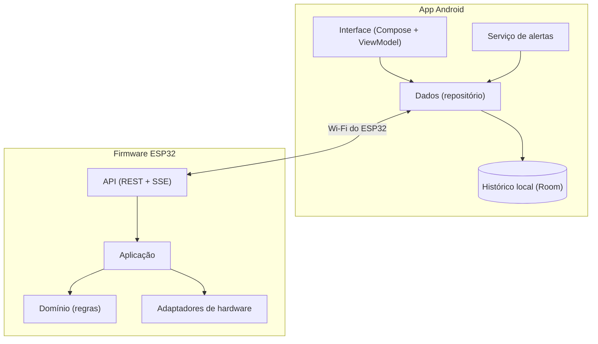

# Arquitetura

Este documento descreve **como o sistema é organizado**. O **porquê** de cada escolha está nas [decisões de arquitetura](decisoes). O objetivo é um código simples de ler, com cada parte cuidando de uma coisa só, sem complexidade que o projeto ainda não precisa.

O código e os comentários do repositório são em inglês. A documentação é em português.

## Visão geral



Há três blocos, e a regra de dependência é a mesma nos dois lados: **o domínio não conhece nada de fora**. Quem depende de quem:

- A interface depende do domínio. O domínio não depende da interface.
- Os detalhes (Wi-Fi, pinos, banco de dados) ficam nas pontas e se encaixam no domínio por interfaces.

## Modelo de dados

O app e o firmware falam a mesma língua, copiada da forma como o Home Assistant organiza uma casa:

| Conceito | No código | Significado | Exemplo |
|---|---|---|---|
| **Cômodo** | `Area` | Um lugar da casa | Cozinha, Quarto |
| **Dispositivo** | `Device` | Uma peça física ou lógica dentro de um cômodo | Sensor de gás, desumidificador |
| **Entidade** | `Entity` | Uma informação ou um controle de um dispositivo | Nível de gás, umidade, liga/desliga |

No código, o cômodo se chama `Area` para não colidir com o `Room`, o banco de dados do Android.

Cada entidade tem um tipo (sensor, sensor binário ou chave) e diz se aceita comandos. O app desenha a tela a partir disso, e por isso um dispositivo novo não obriga a mudar a interface.

Na maquete:

| Cômodo | Dispositivo | Entidades |
|---|---|---|
| Cozinha | Sensor de gás (MQ-2) | nível de gás (sensor), vazamento (sensor binário), válvula (somente leitura) |
| Quarto | Sensor do armário (DHT11) | temperatura, umidade |
| Quarto | Desumidificador (relé) | ligado (chave com comando), modo Automático ou Manual |

O botão de rearme **não é uma entidade**: ele é físico e só existe no ESP32.

O que é "para efeito de maquete" (adicionar cômodo, adicionar dispositivo) é desenhado na interface como item **bloqueado**. Não existe no modelo de dados.

## Firmware (ESP32)

### Camadas

```text
firmware/
├── src/
│   ├── domain/        regras puras, sem Arduino: roda e é testada no computador
│   ├── application/   liga sensores, regras e atuadores; mantém o histórico
│   ├── adapters/      uma classe por peça: MQ-2, DHT11, relé, servo, buzzer, LED, botão
│   ├── api/           REST + SSE, conversão para JSON
│   └── main.cpp       monta tudo (único lugar que conhece as classes concretas)
└── test/              testes do domínio e da aplicação, rodando no computador
```

- **Domínio:** máquina de estados do gás, controle de umidade com dois limites, modo Automático/Manual e a estrutura do histórico. Não inclui `Arduino.h`.
- **Portas:** interfaces pequenas, definidas pelo que o domínio precisa (ler gás, ler clima, ligar uma chave, ler o relógio).
- **Adaptadores:** implementam as portas com o hardware real. É a única parte que precisa da placa para testar.
- **Aplicação:** a cada ciclo, lê as portas, chama o domínio e aplica o resultado. É onde ficam o histórico e a publicação dos eventos.
- **API:** traduz entre HTTP e a aplicação. Não tem regra de negócio.

O `Controle.h` da primeira versão da maquete já separava a regra do hardware. Esta estrutura leva a ideia adiante.

### Regras do domínio

**Gás** (estados `INICIANDO`, `NORMAL`, `EMERGENCIA`):

1. Na partida há uma janela de aquecimento do sensor, com a válvula fechada.
2. Em `NORMAL`, a válvula está aberta.
3. Gás acima do limite leva a `EMERGENCIA`: válvula fechada, LED aceso e buzzer tocando enquanto houver gás.
4. Sair de `EMERGENCIA` exige **as duas coisas**: um período sem gás **e** o aperto do botão físico. O app **não** reabre a válvula.

**Umidade** (modo Automático): liga o desumidificador acima de um limite e só desliga abaixo de outro menor, para o relé não oscilar. Em **Manual**, o comando do app vale e a regra de umidade é ignorada. Voltar a Automático devolve o controle à regra.

Limites e tempos ficam em constantes nomeadas e em um só lugar, porque dependem do sensor real e vão ser calibrados.

### Histórico

O ESP32 guarda as últimas leituras em um buffer circular na memória, com tamanho fixo. O app copia essas leituras para o seu banco local e desenha o gráfico a partir dele. Assim, o histórico já guardado no celular sobrevive a reinícios do ESP32.

O ESP32 não tem hora certa sem internet. Cada amostra registra o tempo desde a partida, e o app envia a hora do celular ao conectar. Um identificador de partida permite ao app perceber que o ESP32 reiniciou e acertar a conversão para a hora real.

## API entre o app e o firmware

- **REST (JSON)** para consultar o estado (`GET`) e enviar comandos (`POST`/`PUT`), versionada em `/api/v1`.
- **SSE** (Server-Sent Events) em um único fluxo, por onde o ESP32 empurra leituras e alarmes assim que acontecem.
- Ao conectar (ou reconectar), o app pede o estado completo antes de ouvir os eventos, para nunca ficar desatualizado.

O contrato detalhado (rotas, formatos, erros) será escrito junto com o firmware, em `docs/api.md`, **antes** do código que o implementa.

## App Android

### Camadas

Segue as [recomendações oficiais de arquitetura do Android](https://developer.android.com/topic/architecture/recommendations):

```text
android/app/src/main/kotlin/.../
├── ui/        telas em Compose; um ViewModel por tela, que expõe um estado imutável
├── domain/    modelos (Area, Device, Entity) e regras de negócio
├── data/      repositórios, cliente do ESP32 (REST + SSE) e banco local (Room)
├── service/   serviço de alertas e notificações
└── di/        montagem manual das dependências (sem framework)
```

- **Fluxo de dados em um só sentido:** a tela mostra um estado e envia ações ao ViewModel. Nunca acessa dados diretamente.
- **Camada de domínio enxuta:** só ganha casos de uso quando há lógica reutilizada por mais de um ViewModel.
- **Injeção de dependência manual:** um único objeto monta as peças. Para este tamanho, um framework só acrescentaria configuração.

### Telas

| Tela | Conteúdo |
|---|---|
| Início | Os cômodos como cartões, mais o cartão bloqueado "Adicionar cômodo" |
| Cômodo | Os dispositivos, mais o cartão bloqueado "Adicionar dispositivo". Na cozinha, o estado do gás e da válvula. No quarto, temperatura, umidade, modo Automático/Manual e a chave do desumidificador |
| Histórico | Gráfico das leituras |
| Sem conexão | Aparece quando o ESP32 não responde e tenta reconectar sozinha |

## Conexão e alertas

- **Rede:** o ESP32 cria a rede Wi-Fi. O Android costuma abandonar redes sem internet, então o app pede a rede explicitamente (`WifiNetworkSpecifier`) e prende o tráfego nela (`bindProcessToNetwork`).
- **HTTP simples:** o Android moderno bloqueia HTTP sem criptografia. O app libera apenas o endereço do ESP32, por meio do arquivo de configuração de segurança de rede.
- **Alertas:** um **serviço em primeiro plano** mantém o fluxo SSE aberto e dispara a **notificação local** quando o ESP32 avisa de vazamento. Não usa Firebase nem internet. A notificação do serviço fica visível enquanto ele roda, o que é uma exigência do Android.
- **Reconexão:** em caso de queda, o app tenta de novo com espera crescente e mostra a tela "Sem conexão".
- **Limite conhecido:** se o usuário encerrar o app à força ou o Android o matar, não há alerta no celular. O alarme sonoro do ESP32 continua funcionando.

## Estratégia de testes

O desenvolvimento é guiado por testes: primeiro o teste que falha, depois o código mínimo que o faz passar, depois a limpeza.

| O quê | Como | Onde roda |
|---|---|---|
| Regras do domínio do firmware | Testes unitários (Unity) pelo PlatformIO, ambiente `native` | No computador |
| Aplicação do firmware | O mesmo, com portas falsas no lugar do hardware | No computador |
| Adaptadores e API do firmware | Verificação manual com a placa e o contrato escrito | Na placa |
| Domínio e dados do app | Testes JVM (JUnit) com um servidor HTTP falso no lugar do ESP32 | No computador |
| Telas do app | Testes de interface do Compose | No computador |
| Sistema inteiro | Roteiro manual com o celular conectado ao ESP32 | Maquete |

Cada pull request traz os testes da mudança.

## Fluxo de trabalho

- Mudanças pequenas, uma por pull request, a partir de um branch.
- A `main` sempre compila e passa nos testes.
- Mensagens de commit no formato `tipo: o que mudou` (`feat`, `fix`, `docs`, `test`, `refactor`).

## Questões em aberto

- **Perda de energia:** o que o desumidificador faz quando o ESP32 reinicia em modo Manual (voltar ao Automático parece mais seguro).
- **Gravação do histórico na flash:** se vale guardar, e com que frequência, por causa do desgaste da memória.
- **Calibração do gás:** o limite atual vem de leituras de bancada e deve ser revisto com o sensor aquecido.
- **Servo que às vezes trava:** problema mecânico conhecido da maquete. Não afeta o software, mas aparece na demonstração.
