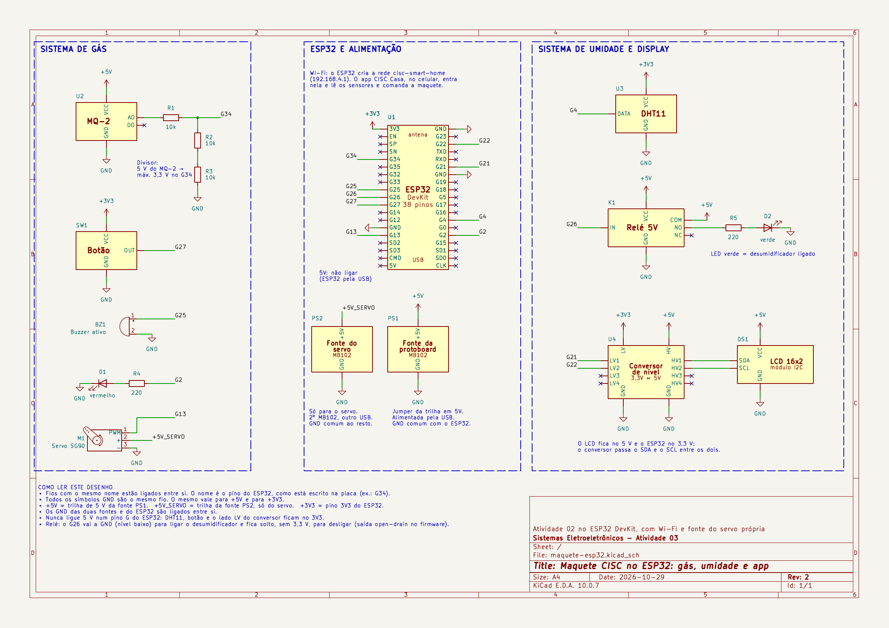

# Hardware da maquete

O esquemático e a lista de materiais da maquete. Para montar e testar, veja também o [roteiro de teste](../docs/roteiro-maquete.md) e o guia [como baixar e rodar](../docs/como-rodar.md).

## Esquemático

- [PDF](esquematico/maquete-esp32.pdf) para ler e imprimir.
- [Projeto do KiCad](esquematico) para editar: abra `maquete-esp32.kicad_pro` no KiCad 9 ou mais novo (a biblioteca das peças, `maquete.kicad_sym`, fica na mesma pasta).

O nome de um fio é o pino do ESP32, como está escrito na placa (por exemplo, `G34`). Todos os símbolos `GND` são o mesmo fio.

| Peça | Pino do ESP32 | Como |
|---|---|---|
| Sensor de gás MQ-2 (saída AO) | G34 | Entrada analógica (ADC1), por um divisor de 10 kΩ e 20 kΩ, porque o MQ-2 trabalha com 5 V e o pino aguenta 3,3 V |
| Sensor DHT11 (dados) | G4 | Entrada digital, alimentado com 3,3 V |
| Botão (módulo, saída OUT) | G27 | Entrada digital; o módulo dá nível alto quando apertado |
| Relé do desumidificador (IN) | G26 | Saída open-drain: GND liga, solto desliga |
| Buzzer ativo | G25 | Saída digital |
| Servo da válvula (sinal) | G13 | Saída PWM; o servo tem uma fonte própria de 5 V, com o GND ligado ao do resto |
| LED vermelho de alarme | G2 | Saída digital, com resistor de 220 Ω |
| LCD 16x2 I2C (SDA e SCL) | G21 e G22 | Por um conversor de nível 3,3 V e 5 V (BSS138), porque o LCD usa 5 V |

Esta é a tabela de `firmware/src/BoardConfig.h`. Se mudar um pino no esquemático, mude lá também.

**Três cuidados.** Nunca ligue 5 V a um pino `G` do ESP32. O servo não deve dividir a fonte com o resto (ele estalava sem corrente). O ESP32 vai na USB; o pino `5V` dele não é ligado.

## Lista de materiais

Só as peças, sem jumpers, fios, MDF, cases e cabos. Os preços são os que a equipe pagou ou consultou (Só Tudo Componentes, 05/10/2026, e as compras de outubro de 2026), em reais.

| Peça | Qtd. | Valor |
|---|---|---|
| ESP32 DevKit, 38 pinos | 1 | R$ 55,90 |
| Sensor de gás MQ-2 | 1 | R$ 14,50 |
| Microservo SG90 | 1 | R$ 14,90 |
| Módulo DHT11 | 1 | R$ 10,90 |
| LCD 16×2 com módulo I2C | 1 | R$ 24,00 |
| Módulo relé 5 V, 1 canal | 1 | R$ 7,90 |
| Buzzer ativo, módulo de botão, 2 LEDs e resistores (220 Ω, 10 kΩ e 20 kΩ) | 1 conj. | R$ 15,30 |
| Conversor de nível lógico BSS138, 4 canais | 1 | R$ 8,00 |
| Fonte ajustável para protoboard (MB102) | 2 | R$ 21,00 |
| Carregador de celular de 5 V e 1 A, ou outra fonte USB de 5 V | 3 | R$ 87,00 |
| **Total** | | **R$ 259,40** |

Os carregadores já existiam; o valor é um preço médio. O ESP32 é o de **38 pinos** (com as etiquetas `G34`, `SP`, `SN`, `5V`…): outros modelos têm os pinos em outros lugares.
